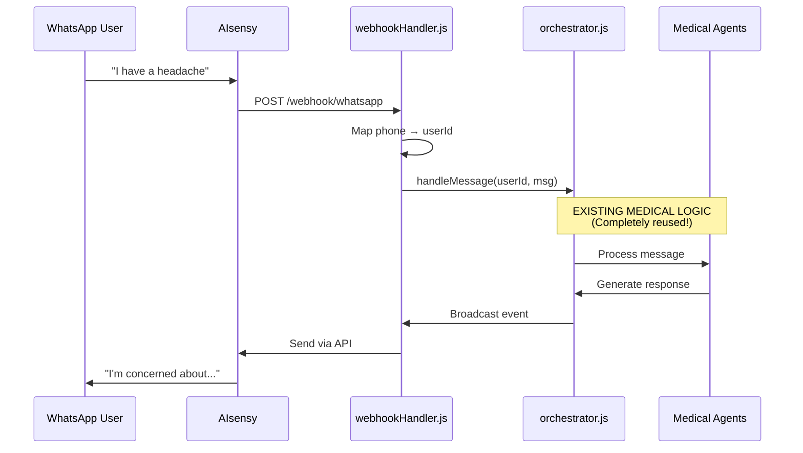

# WhatsApp Integration Guide

**Safe, non-breaking integration of WhatsApp via AIsensy**

---

## ✅ What This Does

Adds WhatsApp as a **parallel client channel**:

```
Before:
  CLI Client → Server → Agents → CLI Client

After:
  CLI Client → Server → Agents → CLI Client     ✅ Still works!
  WhatsApp   → Server → Agents → WhatsApp       ✅ NEW channel
```

**Zero changes to existing medical logic!**

---

## 🚀 Setup Steps

### Step 1: Get AIsensy Credentials

1. Sign up at https://aisensy.com
2. Get your API key
3. Set up WhatsApp Business Account
4. Note your webhook URL

### Step 2: Add to .env

```bash
# Add to your .env file
AISENSY_API_KEY=your_api_key_here
AISENSY_API_URL=https://backend.aisensy.com/campaign/t1/api/v2
```

### Step 3: Install axios (if not already)

```bash
npm install axios
```

### Step 4: Add WhatsApp Tables

```bash
# Run the SQL
sqlite3 care_circle.db < integrations/whatsapp/setup.sql
```

### Step 5: Add Webhook Endpoint to server.js

```javascript
// At top of server.js
import { handleWhatsAppWebhook, sendToWhatsApp } from './integrations/whatsapp/webhookHandler.js';

// Add webhook endpoint (AFTER existing endpoints, around line 100)
app.post('/webhook/whatsapp', async (req, res) => {
    await handleWhatsAppWebhook(req, res);
});

// Update broadcast to send to WhatsApp users too
import { formatForWhatsApp } from './integrations/whatsapp/messageFormatter.js';

events.on('broadcast', async (payload) => {
    // Existing: Send to CLI clients
    broadcast(payload.targetUsers, { type: 'message', ...payload });
    
    // NEW: Also send to WhatsApp if user is on WhatsApp
    for (const userId of payload.targetUsers) {
        const message = formatForWhatsApp(payload.reply || payload.message, {
            from: payload.from,
            patientUsername: payload.patientUsername
        });
        await sendToWhatsApp(userId, message);
    }
});
```

### Step 6: Configure AIsensy Webhook

In AIsensy dashboard:
```
Webhook URL: https://your-server.com/webhook/whatsapp
Events: message.received
```

### Step 7: Test

```
1. Send WhatsApp message to your AIsensy number
2. System should auto-create user
3. Agent responds via WhatsApp
4. Check: CLI client still works ✅
```

---

## 📱 User Experience

### First Contact (Auto-Registration)

```
User WhatsApp: "Hi"

System:
  1. Receives webhook
  2. Creates user: wa_1234 (from phone)
  3. Creates personal care circle
  4. Responds via WhatsApp

WhatsApp Reply:
  "🤖 Your Personal Agent

  👋 Welcome! I'm your personal health assistant.
  
  You can:
  • Talk naturally about your health
  • Add caregivers: /care @name as relationship
  • Add doctors: /doc @name
  • Switch circles: /switch @name
  
  How can I help you today?"
```

### Regular Conversation

```
User: "I took my medication"

Agent: "🤖 Your Personal Agent

Great! Thank you for letting me know.
How are you feeling today?"

[Uses all existing medical logic!]
```

### Commands Work Too

```
User: "/circle"

System: "⚙️ System

👥 Your Care Circle:

You (patient)
• Alice (spouse, caregiver)
• Dr. Smith (doctor)

All set! ✅"
```

---

## 🛡️ Safety Guarantees

### What Doesn't Change
- ✅ CLI client - works exactly as before
- ✅ Medical handlers - untouched
- ✅ Agents - same logic
- ✅ Database - just 3 new tables
- ✅ Existing tests - all pass

### What's Added
- ✅ ONE webhook endpoint
- ✅ Phone number mapping
- ✅ Message formatting
- ✅ Dual-channel broadcasting

---

## 🔧 Advanced Features

### Multi-Channel User

Same user can use BOTH:

```
Morning (via CLI):
  alice@alice> "I feel dizzy"
  [PersonalAgent]: "I'm concerned..."

Afternoon (via WhatsApp):  
  WhatsApp: "Update: feeling better"
  
  System recognizes same user (alice)
  Continues same conversation
  Same care circle context
```

### Channel Preference

```sql
-- Store user's preferred channel
ALTER TABLE users ADD COLUMN preferred_channel TEXT DEFAULT 'cli';

-- Update: 'cli' or 'whatsapp'
```

---

## 📊 Architecture



---

## ✅ What You Get

- 📱 WhatsApp channel for patients/caregivers
- 🔄 Reuses ALL existing medical logic
- 🛡️ Non-breaking (CLI still works)
- 📊 Unified care circles (phone + CLI users together)
- 🤖 Same AI agents
- 📝 Same training/feedback system

---

## 🚨 Rollback Plan

If issues:

**Step 1**: Comment out webhook in server.js
```javascript
// app.post('/webhook/whatsapp', ...);  // Disabled
```

**Step 2**: Restart server

**Result**: Back to CLI-only, WhatsApp disabled

---

**Status**: 🟢 **Ready to integrate**  
**Risk**: 🟡 **Low** (just adds channel, doesn't modify core)  
**Benefit**: 📱 **High** (WhatsApp is standard communication)

Want me to:
1. ✅ Show the exact server.js changes?
2. ✅ Create test script?
3. ✅ Add error handling?

