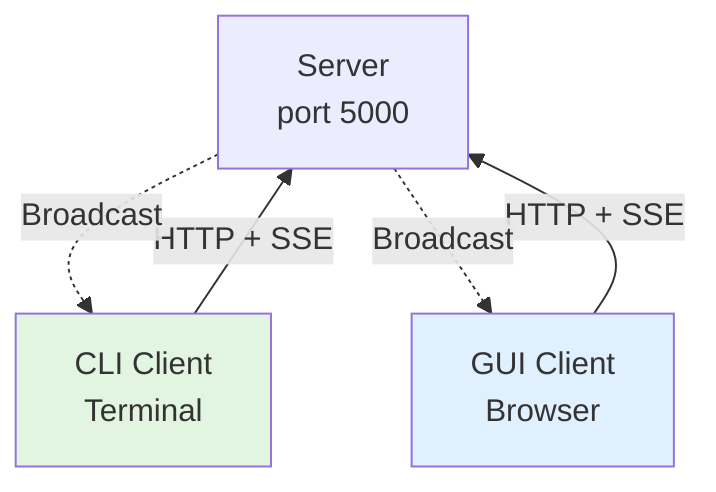

# Testing GUI + CLI Together

## ✅ YES, They Can Run Simultaneously!

### Test Scenario

```
Terminal 1:
> node server.js
[Server] Listening on port 5000

Terminal 2:
> node client/main.js
alice> "Hello from CLI"

Browser:
> http://localhost:5000/gui/
> Login as: alice
> Type: "Hello from GUI"

Result:
✅ Both connected to same server
✅ Both use same user account
✅ Messages appear in both interfaces
✅ Real-time sync via SSE
```

### How It Works



**Both receive same broadcasts!**

---

## Test It

```bash
# Terminal 1: Server
node server.js

# Terminal 2: CLI as Alice
node client/main.js
# Login: alice

# Terminal 3: CLI as Bob  
node client/main.js
# Login: bob

# Browser: GUI as Alice
http://localhost:5000/gui/
# Login: alice

# Now:
# - Two Alice instances (CLI + GUI) ✅
# - One Bob instance (CLI) ✅
# - All receive messages ✅
# - All can send ✅
```

**Answer**: ✅ **YES, perfect!** Multiple clients, same server.

